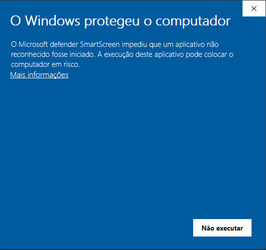

# Gestor de Despesas Mensais

Programa que lê faturas e regista as despesas num mapa anual em Excel, organizado
por mês. Numa casa partilhada, divide as contas da casa pelas pessoas que lá
moravam em cada mês. Também pode ser usado só para as despesas de uma pessoa, ou
para um pequeno negócio (ganhos, agenda e lucro).

## O que ele lê

- **PDFs** de faturas, como os que chegam por e-mail;
- **fotografias** de talões, tiradas com o telemóvel;
- o ficheiro que se descarrega do **portal e-fatura** das Finanças.

Para cada fatura, identifica o emitente, o valor e o mês. As que não consegue
ler ficam numa lista no programa, para lhes dares o valor à mão.

## Começar

### Windows

1. Descarrega o **`Instalar-Gestor-de-Despesas-<versão>.exe`** da
   [versão mais recente](https://github.com/tiagompita/gestor-de-despesas/releases/latest).
2. Faz duplo clique nele. Não precisas de instalar mais nada antes: se faltar o
   Python, o instalador explica o que é e instala-o. Não pede administrador.
3. No fim fica um atalho **Gestor de Despesas** no menu Iniciar.

#### Vais ver este aviso — é normal

Ao abrires o instalador pela primeira vez, o Windows mostra isto:



Aparece porque o instalador não tem uma assinatura digital paga, e não porque o
Windows tenha encontrado algum problema nele. Para continuar:

1. Carrega em **Mais informações** (não em «Não executar»).
2. Aparece o botão **Executar mesmo assim**: carrega nele.

**O ficheiro é seguro:** a versão 1.20 do instalador foi analisada por dezenas
de antivírus no VirusTotal —
[ver a análise](https://www.virustotal.com/gui/file/c11c9081112567c62a39e1c9efcb18dcc1886e05200c0c12f171cbde2102d86c).
Para confirmares que o ficheiro que descarregaste é esse mesmo, abre o
PowerShell na pasta dele e escreve:

```
Get-FileHash .\Instalar-Gestor-de-Despesas-1.20.exe
```

O resultado tem de ser
`C11C9081112567C62A39E1C9EFCB18DCC1886E05200C0C12F171CBDE2102D86C`.

Para desinstalar, há **Desinstalar o Gestor de Despesas** no menu Iniciar. As tuas
faturas e o teu mapa só são apagados se responderes que sim.

### Mac e Linux

1. Instala o **Python** 3.11 ou mais recente:
   [python.org/downloads](https://www.python.org/downloads/) (no Mac também
   `brew install python python-tk`; no Linux,
   `sudo apt install python3 python3-venv python3-tk`).
2. Descarrega o **`Despesas-Mensais.zip`** da
   [versão mais recente](https://github.com/tiagompita/gestor-de-despesas/releases/latest)
   e extrai-o para uma pasta à tua escolha.
3. Abre um terminal nessa pasta e corre `./executar_despesas.sh`.

### Depois de instalar

Da primeira vez abre um assistente que pergunta o teu nome, se partilhas casa e
que despesas tens.

Depois disso: pões as faturas na pasta `faturas_pessoal` (o botão
**📂 Pasta das faturas** abre-a) e carregas em **Atualizar Excel**. O botão
**Abrir o Excel** abre o mapa.

## Versões novas

Quando há uma versão nova, aparece um **●** no botão **⚙ Definições**. Instala-se
em **⚙ Definições › Atualizações › Instalar a versão nova**. As faturas, o mapa e a
configuração não são alterados.

Os teus dados são também copiados, sempre que abres o programa, para
`Documentos\Gestor de Despesas\backup`. Em **⚙ Definições › Backup** escolhes um
dia para os repor.

---

## Guardar o mapa no Google Drive

Opcional e desligado por omissão. Quando está ligado, no fim de cada atualização
o programa envia o mapa e as faturas arquivadas para uma pasta do teu Google
Drive. Só envia o que mudou desde o último envio.

O envio é feito pelo **rclone**, um programa à parte. Configura-se uma vez, em três
passos.

### 1. Instalar o rclone

- **Windows:** em **⚙ Definições**, liga **«Enviar o mapa e os documentos para o
  Google Drive»**. Se faltar o rclone, abre-se uma caixa com o botão
  **Instalar agora**, que o descarrega do site oficial e o confere. No fim, a
  caixa mostra o comando do passo 2, com um botão **Copiar o comando**.
- **Mac:** `brew install rclone`
- **Linux:** `sudo apt install rclone`

### 2. Dar ao rclone acesso ao teu Drive

Abre um terminal e escreve:

```
rclone config create upload_despesas_googledrive drive scope=drive
```

> No Windows, usa o comando que a caixa do passo 1 te deu: é este, com o caminho
> completo do `rclone.exe`.

Abre-se o navegador. Entra na tua conta Google e carrega em **Permitir**.

Para confirmar, este comando tem de mostrar as pastas do teu Drive:

```
rclone lsd upload_despesas_googledrive:
```

### 3. Ligar o envio no programa

Em **⚙ Definições**, confirma que **«Enviar o mapa e os documentos para o Google
Drive»** está ligado e grava. Na próxima atualização, o mapa aparece no teu Drive,
numa pasta **`Despesas`**, dentro de uma subpasta com o teu nome.

### E se quisermos todos a mesma pasta?

Para guardar os mapas de várias pessoas na mesma pasta:

1. Uma pessoa cria uma pasta no Drive e partilha-a com as outras, como
   **Editor**.
2. Cada pessoa abre essa pasta no navegador e copia o código que aparece no
   endereço, depois de `/folders/`.
3. No passo 2, em vez do comando de cima, cada pessoa usa este, com o código no
   fim:

   ```
   rclone config create upload_despesas_googledrive drive scope=drive root_folder_id=O_CODIGO
   ```

Cada pessoa usa a sua conta Google, e cada mapa fica numa subpasta com o nome da
pessoa, dentro da pasta partilhada.

> **Não partilhes o ficheiro `rclone.conf`.** Dá acesso total à conta Google de
> quem o criou, e não só à pasta das despesas.

### Se não estiver a enviar

O motivo aparece no fim de cada atualização:

- **«O rclone não está instalado»:** falta o passo 1.
- **«…o rclone do sistema não conhece o remote…»:** o passo 2 ficou com outro nome.
  Usa exatamente `upload_despesas_googledrive`, ou escreve o nome que escolheste em
  **⚙ Definições › Remote rclone**.
- **Um erro de autorização do Google:** a ligação expirou. Corre
  `rclone config reconnect upload_despesas_googledrive:` e volta a entrar.

Antes de apagar mais de 20 ficheiros do Drive de uma vez, o programa pede
confirmação.
